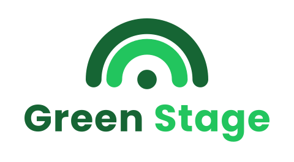

<div align="center">
  

**Discover events. Connect with experiences.**

An Android application for discovering and exploring events.

  <br />


</div>

---

## About

Green Stage is an Android application designed to make event discovery easier. Users can explore upcoming events, view event details, bookmark interesting events, and stay informed about what's happening around them.

The application aims to provide a simple and intuitive experience for discovering events.

## Features

- **Event Discovery** - Browse and explore upcoming events.
- **Event Details** - View event descriptions, dates, venues, and other information.
- **Bookmarks** - Save interesting events for later.
- **User Authentication** - Secure user registration and login.
- **User Profile** - Manage personal account information.

## Tech Stack

| Technology | Purpose |
|---|---|
| Kotlin | Primary programming language |
| Android SDK | Android application development |
| Jetpack Compose | UI development |
| Firebase Authentication | User authentication |
| Cloud Firestore | Database |
| Firebase Storage | Event images and posters |
| Firebase Cloud Messaging | Push notifications |

## Getting Started

### Prerequisites

- Android Studio (latest stable version)
- JDK compatible with the project's Gradle configuration
- Android SDK
- Git

### Installation

1. Clone the repository:

   ```bash
   git clone <repository-url>
   ```

2. Navigate to the project directory:

   ```bash
   cd GreenStage
   ```

3. Open the project in Android Studio.

4. Allow Gradle to sync and download the required dependencies.

5. Configure Firebase by adding your `google-services.json` file to the `app/` directory.

6. Run the application using an Android emulator or a physical Android device.

## Documentation

Project documentation is maintained in the `docs/` directory.

| Document | Description | File |
|---|---|---|
| [Database](/docs/database.md) | Data models, schema and contracts | 
| [Architecture](/docs/architecture.md) | Application architecture and flow |
| [API & Repository](/docs/api-and-repository.md) | Data access and repository contracts |
| [Screens & Navigation](/docs/screens-and-navigation.md) | Screen specifications and navigation |
| [Authentication & Authorization](/docs/authentication-and-authorization.md) | Authentication and access control |
| [Firebase](/docs/firebase.md) | Firebase configuration and integration |

## Development Status

<badge color="warning">In Development</badge>

Green Stage is currently under active development. 
Features and implementation details may change as the project evolves.